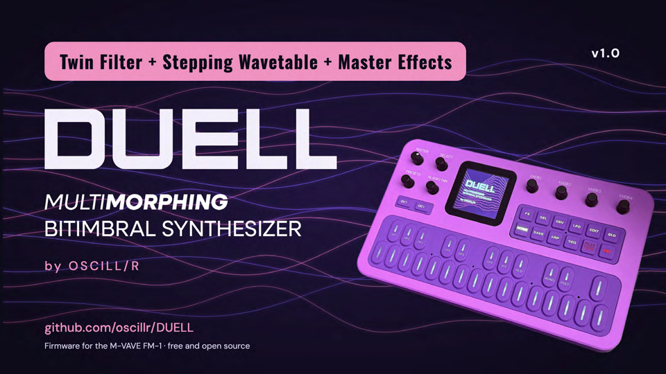

# DUELL

**MultiMorphing Bitimbral Synthesizer**  
**by OSCILL/R**

**Two synths in one small box.** DUELL is free, open-source firmware (GPL-3.0) for the M-VAVE FM-1. It turns the FM-1 into a bitimbral instrument: two complete parts, three ways to play them together, and a morph that glides between two versions of every sound. This is **DUELL 1.0**.

**Try it in your browser, no FM-1 needed:** <https://oscillr.github.io/DUELL/emu/>

> **Install at your own risk.** DUELL has been flashed to and run on **one real FM-1, the author's**. The way back to the official firmware (V15) has worked on that unit; it has not been tried on others. The FM-1 has a single copy of its firmware and no known rollback. Back up first. Read [docs/RECOVERY.md](docs/RECOVERY.md) and [docs/KNOWN_LIMITS.md](docs/KNOWN_LIMITS.md). No warranty. DUELL is not affiliated with M-VAVE.

## Install and update

1. Use **Chrome or Edge** on a computer (the installer needs WebMIDI with SysEx), a **data** USB cable straight into the computer (no hub), and an FM-1.
2. Open the installer page: <https://oscillr.github.io/DUELL/install/>. Save a backup, press Install, wait for Done, then switch the unit off and on once.
3. While the new firmware is written, the unit shows the **update screen**: the DUELL word over moving wave lines, WRITING, a percent number, a bar of 20 segments and DO NOT SWITCH OFF. Do not unplug until it is done. If the screen stays dark the write may still be running: wait for the installer to say Done.
4. Details, the checklist and the way back to the official firmware: [docs/INSTALL.md](docs/INSTALL.md). If something goes wrong: [docs/RECOVERY.md](docs/RECOVERY.md).

The package is `duell-1.0.fwsc` (compare its SHA-256 with `SHA256SUMS` on the release page).

## What is in it

### Two parts, three modes
Part 1 and Part 2 each have their own sound, effects, EQ, ducker and arp.

| Mode | What you get |
|---|---|
| **DUEL** | Dual mono. Part 1 hard left, part 2 hard right, isolated, effects included. |
| **STEREO** | Both parts in one stereo field, for headphones. |
| **LAYER** (the default) | Both parts on the keys at once, with balance, velocity crossfade and key split. The heart of DUELL. |

### MORPH
Glide between two versions of the same patch with one fader. End A is the sound; End B is rolled by a smart randomizer from your starting point (ROLL, UNDO, AMOUNT). Up to 32 values of End B can be set by hand and stay when it is saved.

### Ten engines
ANALOG, PHASE, LOFI, VOICE, TRIO, WHEEL, PHYS, NOISE, FM6 and WAVE (with three user wavetables made from a WAV file in the editor). Every engine has the same filter section:
- **MULTI FILTER**: the multimode filter (CUT, RES, MODE, SLOPE, key tracking, envelope and LFO depth).
- **TWIN FILTER**: a second filter with the types OFF, LP, BP, HP, NOTCH, LADDER and COMB, its own cutoff (or an offset in whole semitones from the MULTI FILTER with LINK), resonance, DRIVE, SERIES or PARALLEL routing and a BLEND that reads MULTI, BOTH or TWIN.
- A **SUB OSC** layer (sine, triangle, square or pulse, an octave or two down), **WAVE STEPS**, and a **CYCLE** envelope that can run as a modulation source.

### Factory content
- **128 patches**, sorted by category (24 BASS, 19 LEAD, 21 PAD, 14 PLUCK, 16 KEYS, 7 PERC, 16 FX, 11 OTHER). The bank is levelled with each patch's TRIM. New in 1.0: **#25 DRIVEN SAW**, a driven lead that uses both filters in series. The list of numbers is [docs/PATCH_NUMBERS.md](docs/PATCH_NUMBERS.md).
- **16 MULTI slots**: 15 factory multis (REESE SWAMP, NIGHT ORGAN, PAD SPLIT, DUB CHORD, WHISPER TIDE, TINE STRINGS, FINAL REEL, HAZY TENSOR, ACID ETHER, WIRED SNAIL, EERIE SIGNAL, DEAD BUFFER, COLD CHAPEL, GARGLE ACID, WOOD & SKIN), their levels balanced and each with its own End B, and M16 STRESS TEST, a CPU test that you can overwrite.
- **32 patterns**, P01 to P32, all filled with a default and all overwritable.
- Save any patch into any of the 128 slots; RESTORE brings the slot's factory sound back.

### Level
A part has two levels, as on a hardware synth. The sound has a **TRIM** (its own loudness, saved with the patch) and the mixer has a **LEVEL** (your volume for the part: loading a sound does not change it, a multi remembers it). The MASTER's top is 0 dB.

### Effects
Per part: distortion, INSERT (including TAPE, VINYL, FOLD, HARD, CRUSH), EQ, a ducker with sidechain from MIDI. Shared: chorus (stereo), a delay with four modes (DIGI, PING, RAND, OCT+), six reverbs (ROOM, SPRING, HALL, SHIM, RESO, PLATE) with a low cut, BASS MONO, a master compressor and a stereo WIDTH on the GLO pages.

### Keys
Key velocity and aftertouch (KEY SENSE): the menu has **AFTERTOUCH** (on by default) and **KEY VELOCITY** (off by default: with it on, a very hard press can come out quiet; the method is Velo's, see [NOTICE.md](NOTICE.md)).

### Two cores
Part 2 plays on the chip's second core. It starts at every power-on and needs nothing from you. If the second core does not answer, misreads or stalls, DUELL plays on **one core** for the rest of that session without a break in the music; after a crash or hang that involved the second core, the next start uses one core too and the one after tries two again. The unit also keeps a limit on the number of notes per part (the NOTES budget) so that it does not crackle. There is no menu switch or on-screen notice for the second core yet.

### MIDI
A MIDI channel for each part. Clock in (AUTO, INT, USB or TRS), program change, bank select, pitch bend, mod wheel, sustain pedal and the CC map below. MIDI LEARN teaches a CC to any other parameter. Not tested with a wide range of devices.

### USB, the editor and the backup
The unit shows up as **DUELL** (USB-MIDI; USB audio input as set in the menu). The web editor, <https://oscillr.github.io/DUELL/editor/> (Chrome or Edge, unit connected), edits both parts live: all parameters, the ENGINE selector, the patch library for the 128 slots (export, import, drag between slots, DX7 `.syx` import), the MULTIS, a piano roll for the patterns, wavetable files and a Backup page that saves and restores everything (patches, multis, patterns, wavetables, settings). The editor has **no MIDI MAP tab yet**; assignments are made on the unit with MIDI LEARN. Try the editor without a unit with `?mock=1` on its address.

## MIDI CC map

One map for the whole unit. A CC on a part's channel moves that part; "both parts" rows answer on any channel. Generated from [docs/MIDI_MAP_DEFAULTS.csv](docs/MIDI_MAP_DEFAULTS.csv): **70** direct CCs, **23** locked and input numbers, 35 unused.

**Direct CCs**

| CC | On the unit | MIDI standard name | Scope |
|---|---|---|---|
| 5 | GLIDE | Portamento Time | the part of the channel |
| 7 | LEVEL (mixer level of the part) | Channel Volume | the part of the channel |
| 10 | PAN | Pan | the part of the channel |
| 12 | INSERT A | Effect Control 1 | the part of the channel |
| 13 | INSERT B | Effect Control 2 | the part of the channel |
| 14 | SUB LEVEL | Undefined | the part of the channel |
| 15 | SUB OCTAVE | Undefined | the part of the channel |
| 16 | SUB WAVE | General Purpose Controller 1 | the part of the channel |
| 17 | SUB HARMONICS (the HARM card is switched off for now: no effect) | General Purpose Controller 2 | the part of the channel |
| 18 | MULTI FILTER ENV AMT | General Purpose Controller 3 | the part of the channel |
| 19 | MULTI FILTER KEY TRK | General Purpose Controller 4 | the part of the channel |
| 20 | MULTI FILTER MODE | Undefined | the part of the channel |
| 21 | TWIN CUTOFF | Undefined | the part of the channel |
| 22 | TWIN RES | Undefined | the part of the channel |
| 23 | TWIN FILTER ENV AMT | Undefined | the part of the channel |
| 24 | TWIN FILTER KEY TRK | Undefined | the part of the channel |
| 25 | TWIN FILTER TYPE | Undefined | the part of the channel |
| 26 | TWIN DRIVE | Undefined | the part of the channel |
| 27 | TWIN BLEND | Undefined | the part of the channel |
| 28 | TWIN ROUTE (SERIES / PARALLEL) | Undefined | the part of the channel |
| 29 | TWIN LINK | Undefined | the part of the channel |
| 30 | LFO 1 to TWIN CUTOFF | Undefined | the part of the channel |
| 31 | LFO 2 to TWIN CUTOFF | Undefined | the part of the channel |
| 34 | SPREAD | LSB for CC 2 | the part of the channel |
| 35 | SATURATION | LSB for CC 3 | the part of the channel |
| 36 | INSERT C | LSB for CC 4 | the part of the channel |
| 41 | MULTI FILTER SLOPE | LSB for CC 9 | the part of the channel |
| 44 | E1 (engine value 1) | LSB for CC 12 | the part of the channel |
| 45 | E2 (engine value 2) | LSB for CC 13 | the part of the channel |
| 46 | E3 (engine value 3) | LSB for CC 14 | the part of the channel |
| 47 | E4 (engine value 4) | LSB for CC 15 | the part of the channel |
| 48 | E5 (engine value 5) | LSB for CC 16 | the part of the channel |
| 49 | E6 (engine value 6) | LSB for CC 17 | the part of the channel |
| 50 | E7 (engine value 7) | LSB for CC 18 | the part of the channel |
| 51 | E8 (engine value 8) | LSB for CC 19 | the part of the channel |
| 52 | ENV 2 ATTACK | LSB for CC 20 | the part of the channel |
| 53 | ENV 2 DECAY | LSB for CC 21 | the part of the channel |
| 54 | ENV 2 SUSTAIN | LSB for CC 22 | the part of the channel |
| 55 | ENV 2 RELEASE | LSB for CC 23 | the part of the channel |
| 70 | MORPH FADER | Sound Controller 1 (Sound Variation) | the part of the channel |
| 71 | MULTI FILTER RESONANCE | Sound Controller 2 (Timbre / Harmonic Intensity) | the part of the channel |
| 72 | AMP RELEASE | Sound Controller 3 (Release Time) | the part of the channel |
| 73 | AMP ATTACK | Sound Controller 4 (Attack Time) | the part of the channel |
| 74 | MULTI FILTER CUTOFF | Sound Controller 5 (Brightness) | the part of the channel |
| 75 | AMP DECAY | Sound Controller 6 (Decay Time) | the part of the channel |
| 76 | LFO 1 RATE | Sound Controller 7 (Vibrato Rate) | the part of the channel |
| 77 | LFO 1 to PITCH | Sound Controller 8 (Vibrato Depth) | the part of the channel |
| 78 | LFO 1 FADE | Sound Controller 9 (Vibrato Delay) | the part of the channel |
| 79 | AMP SUSTAIN | Sound Controller 10 (no default) | the part of the channel |
| 80 | CHORUS RATE | General Purpose Controller 5 | both parts (any channel) |
| 81 | CHORUS DEPTH | General Purpose Controller 6 | both parts (any channel) |
| 82 | DELAY TIME | General Purpose Controller 7 | both parts (any channel) |
| 83 | DELAY FEEDBACK | General Purpose Controller 8 | both parts (any channel) |
| 85 | DELAY COLOUR | Undefined | both parts (any channel) |
| 86 | DELAY MIX | Undefined | both parts (any channel) |
| 87 | REVERB SIZE | Undefined | both parts (any channel) |
| 89 | REVERB DAMP | Undefined | both parts (any channel) |
| 90 | REVERB LOW CUT | Undefined | both parts (any channel) |
| 91 | REVERB send | Effects 1 Depth (Reverb Send) | the part of the channel |
| 92 | DELAY send | Effects 2 Depth | the part of the channel |
| 93 | CHORUS send | Effects 3 Depth (Chorus Send) | the part of the channel |
| 94 | DETUNE | Effects 4 Depth | the part of the channel |
| 95 | INSERT MIX | Effects 5 Depth | the part of the channel |
| 102 | MORPH ROLL: 0 to 42 rolls End A, 43 to 84 nothing, 85 to 127 rolls End B | Undefined | the part of the channel |
| 103 | MORPH AMOUNT | Undefined | the part of the channel |
| 114 | CYCLE MODE | Undefined | the part of the channel |
| 115 | CYCLE RISE | Undefined | the part of the channel |
| 116 | CYCLE FALL | Undefined | the part of the channel |
| 117 | CYCLE CURVE | Undefined | the part of the channel |
| 118 | CYCLE SYNC | Undefined | the part of the channel |

**Input numbers** (read as performance controls for the modulation matrix): CC1 mod wheel (it also moves the morph fader), CC11 expression, CC64 sustain pedal. **CC2 (breath) and CC4 (foot)** are reserved as matrix sources but are **not read yet**.

**Locked numbers** (the MIDI standard's own): 0 and 32 bank select, 6 and 38 data entry, 96 to 101 data increment / decrement and NRPN / RPN select, 120 to 127 the channel mode messages (all sound off, reset all controllers, local control, all notes off, omni, mono, poly).

**Unused:** 8, 56 to 63 and the others not listed.

**Learn-only parameters** have no CC of their own: the matrix choices and amounts, EQ, ARP and SEQ set-up, DUCK, the LFOs beyond the vibrato rows, the voice set-up, the master settings, UNDO, the four MORPH switches (TARGET, SMART, ARP, PITCH) and the settings that belong to both parts (BALANCE, XFADE, SPLIT, MODE). Teach a CC to one with MIDI LEARN on the unit.

## What is not in 1.0
The editor's MIDI MAP tab, BREATH and FOOT as matrix sources, switching multis with preset changes, the SUB HARMONICS card (switched off). The full list is in [docs/KNOWN_LIMITS.md](docs/KNOWN_LIMITS.md).

## Build and test

Building a device image is described in [felucca-base/BUILDING.md](felucca-base/BUILDING.md); a normal build has the two-core firmware and the update screen. Host tests: `./host_tests.sh` (see [docs/TESTING.md](docs/TESTING.md)).

## Read more

| I want to... | Read |
|---|---|
| Install or update | [docs/INSTALL.md](docs/INSTALL.md) |
| Play it | [docs/QUICKSTART.md](docs/QUICKSTART.md) |
| Fix a problem | [docs/TROUBLESHOOTING.md](docs/TROUBLESHOOTING.md) |
| Recover from a failed flash | [docs/RECOVERY.md](docs/RECOVERY.md) |
| Know the limits | [docs/KNOWN_LIMITS.md](docs/KNOWN_LIMITS.md), [docs/KNOWN_ISSUES.md](docs/KNOWN_ISSUES.md) |
| See what changed | [CHANGELOG.md](CHANGELOG.md), [RELEASE_NOTES.md](RELEASE_NOTES.md) |
| Read the full design | [SPEC.md](SPEC.md) |
| Report a bug | the [bug report form](https://github.com/oscillr/DUELL/issues/new/choose) |

## Credits and licence

DUELL is a fork of **Felucca** by Leo Kuroshita (@kurogedelic), Hügelton Instruments, and is licensed under the **GPL-3.0-only** ([LICENSE](LICENSE)). The whole list of thanks and of third-party parts is in [CREDITS.md](CREDITS.md), [NOTICE.md](NOTICE.md) and [felucca-base/LICENSING.md](felucca-base/LICENSING.md); the upstream commit is in [UPSTREAM_COMMIT.txt](UPSTREAM_COMMIT.txt). The DUELL logo and artwork are the work of OSCILL/R and are not part of the GPL licence; the code and the splash graphic as shipped in the firmware are GPL-3.0-only. DUELL is an independent project and is not affiliated with M-VAVE.
