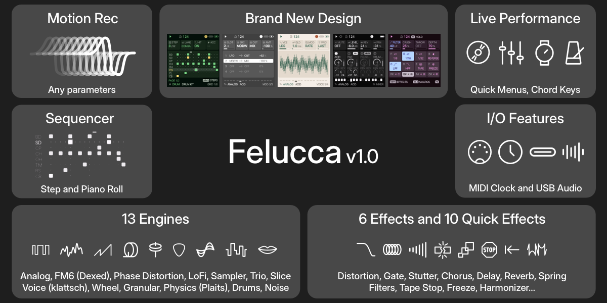
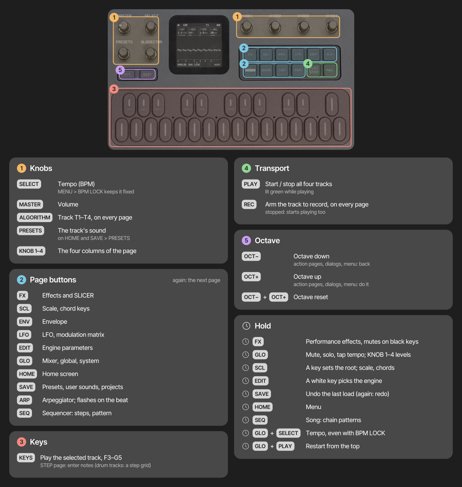

# Felucca

**TL;DR:** Felucca 1.5 — an INSERT effect on every track, MIDI LEARN on the device, ANALOG's band-pass and high-pass, ENV SYNC, note lengths and per-step velocity, field testing. Connect your FM-1 to a computer by USB,
open the [web installer](https://hugelton.github.io/Felucca/) in Chrome or Edge, and press Install;
no extra hardware is needed. Installing is at your own risk: M-VAVE's updater or the installer's
**Return to official V15** takes you back. Coming from 1.1.5.x? Read [⚠ Coming from 1.1.5](#-coming-from-115) first:
projects saved by 1.4 or later do not open on 1.1.5.x. Going back from 1.5 to 1.4.1? Read
[⚠ New in 1.5](#new-in-15) first: projects saved by 1.5 do not open on 1.2 to 1.4.1. Want to look around first?
[Try it in your browser](https://hugelton.github.io/Felucca/webapp/try/), no FM-1 needed.

Multi-engine synthesizer firmware for the M-VAVE FM-1. Please report what you find in
[Issues](https://github.com/hugelton/Felucca/issues).

- Install: [web installer](https://hugelton.github.io/Felucca/) (Chrome or Edge, USB), or `tools/fm1_install.py` from a terminal
- Try: [Felucca in your browser](https://hugelton.github.io/Felucca/webapp/try/): the same firmware compiled to
  WebAssembly, with the panel on screen (mouse, touch, computer keyboard, Web MIDI in)
- Editor: [web editor](https://hugelton.github.io/Felucca/webapp/editor/); its development has moved to
  [Felucca-WebApp](https://github.com/hugelton/Felucca-WebApp)
- Build: [BUILDING.md](BUILDING.md)

## Features

- **Thirteen engines** (below), each with its own factory presets; every factory sound has a category (BASS, LEAD,
  PAD, PLUCK, KEYS, DRUM, FX, OTHER) to browse by
- **Four tracks**, one synth part each with its own engine and sound (drums are the DRUM engine);
  8 voices shared between them. ALGORITHM selects the track on every page
- **Sequencer:** 64 steps per track with chords, ties, accent, slide, per-step chance, velocity and ratchets
  (a step played 2, 3 or 4 times in its length); a piano roll of the steps, where KNOB 3 sets a note's length; a drum grid (white keys =
  steps, black keys = lanes); automation: recording of knob moves per step (an automation icon marks the cards it
  drives); live loop recording with overdub; step recording at the cursor (REC on SEQ > STEP while stopped), one
  chord at a time or note by note (MENU > CHORD ENTRY ADD); divisions listed by length, 4 bars to 1/32; loading a
  sound never touches your patterns
- **Timing:** live recording keeps when you played each note, as a per-step **NUDGE** (1/16 of a step, half a step
  early to 7/16 late); the track's **QUANTIZE** decides what plays: ON (the default) every step on the grid, as
  always, OFF your own timing. Nudges can also be set by hand
- **Parameter locks and the AUTOMATION list:** hold a step on SEQ > STEP (or the drum grid) and turn a knob to set
  that parameter for that step only; EDIT with the step held clears its locks. **SEQ > AUTOMATION** is one list of
  everything that happens on the track's steps: PLAY / CLEAR, QUANTIZE, each step's CHANCE, RATCH, NUDGE and VEL, its
  locks and automation events; change their step, parameter or value, turn a lock into automation or back, add or
  delete one. 128 records shared by the four tracks. SAVE held undoes every edit
- **SEQ TOOLS:** hold SEQ on any page for tools on the keys: CLEAR, REVERSE, SHIFT < / >, **RANDOM** (a new beat,
  or new notes in the scale on the same rhythm) and **COOK** (changes the pattern a little each press); on a DRUM
  track also BEAT and each lane's CLEAR, REVERSE, FILL and RANDOM; KNOB 1–4 are LEN, DIV, SWING and GATE. Each tool
  is one undo (SAVE held); OCT− puts the track back as the layer found it
- **Metronome and count-in:** CLICK (OFF, while recording, or always) with three levels, and a count-in
  of 1 or 2 bars before recording from stop; the click goes to the headphones and speaker only, never to
  USB audio or into a pattern
- **Songs** (GLO > SONG): up to 16 sections, each naming the project slot (A–D) **every track** plays, or "-" for a
  track that rests there, with its repeats; drawn as a timeline with a lane per track
- **Chord keys:** one finger plays an in-key chord (triads or sevenths of the scale, or fixed chord
  shapes), with voicings; on the keys, MIDI in, recording and the arpeggiator
- **Arpeggiator** with UP, DN, UPDN, RND, ORD (the notes in the order you pressed them), REPEAT and, for chords,
  DNUP, UP+8, CONV, DIVG, PINKY, THUMB, WALK and CHORD; a beat LED; 16 scales with a white-key mode, glide,
  MONO / LEGATO / UNISON
- **LFO:** RATE or **SYNC** to a note value (4 bars to 1/32, following the tempo or an external clock), **TRIG** NOTE
  or FREE, **POL** bipolar or unipolar (LFO > LFO 2)
- **Modulation matrix:** 4 slots per track, MIDI controllers as sources, **S&H** and **SLEW** (a random value per
  LFO cycle, held or gliding), and **DEPTH** as a destination, so the matrix can modulate the LFO itself
- **SPREAD** (EDIT > VOICE 3): the voices of a POLY or UNISON track alternate left and right of its PAN
- **ENV SYNC** (ENV > ENV DEST): the envelope's attack, decay and release as note values of the tempo
- **Effects:** distortion, an **INSERT** (drives, CRUSH, phaser, flanger, chorus, with a dry / wet MIX) and the
  SLICER per track; chorus, delay and reverb sends (the reverb as
  **HALL**, ROOM, SPRING, SHIM or RESO; HALL is a smooth stereo reverb, the default on a fresh start); master limiter
- **FX layer:** hold FX for repeat, reverse, filter sweeps, tape stop, freeze, a harmonizer
  (OCT UP / OCT DN with shimmer), **FLANGER** and **PHASER** (in time with the tempo), and mutes on the black keys;
  any white key can hold any effect (hold the key in the layer and turn PRESETS); MENU > FX LATCH makes them toggle,
  so nothing has to stay held
- **MOMENTARY:** hold LFO and turn a knob on HOME or a sound / FX page; let go of LFO and the value jumps back
  (OCT+ while holding keeps it)
- **Quick layers:** hold FX, GLO, SCL, EDIT, REC or SEQ for shortcuts on the keys and knobs, or double-tap it to
  keep the layer open; one-step undo (SAVE held); REC on every page; OCT+ confirms, OCT- goes back; what can be
  pressed breathes softly instead of blinking
- **Presets:** factory presets, 32 user preset slots and 4 projects, named on the device (an FM6
  sound keeps its own patch in both); user presets get a category, and a project can get a random name; projects
  from every earlier version load. The PRESETS knob changes the sound from every page that is not a list.
  Turn the FM-1 off and on and the music is as you left it (MENU > RESTORE LAST, an autosave of its own,
  written only when stopped and idle)
- **Hold SAVE saves over the patch you are editing** (SAVE OVER <name>?, OCT+ yes); on PATTERNS and MULTIS it saves over the
  slot picked. A short press of SAVE opens PATTERNS from the sequencer, otherwise MULTIS in LAYER and PATCHES in SPLIT and STEREO
- **Screen:** flat UI with Inter Tight and Fukiai icons, 10 palettes including
  grayscale, black and white, high contrast and NIGHT; type in sizes by role (what you read in the larger size,
  labels and hints in the smaller); the menu in
  four tabs. The header shows the track and the **project slot of its pattern** ("1 A", "1 A*" once edited), the
  play state and the tempo. HOME shows the oscilloscope or, with MENU > HOME TRACKS, **the four tracks** with their
  steps playing (LEVELS: with the four tracks' levels on the knobs); the screen can go dark when the panel is left
  alone (MENU > SCREEN OFF)
- **LEDs:** idle buttons and keys glow dim so the panel can be found in the dark (MENU > LEDS: OFF,
  DIM LO, DIM HI or INV, the official firmware's look); PLAY turns green while playing; the keys show
  the notes the sequencer and MIDI IN play, and on SEQ > STEP (stopped) the notes of the step under the cursor;
  the drum grid marks the beats (steps 1, 5, 9, 13); MENU > SCALE LEDS shows the track's scale on the keys;
  a soft light sweeps over the keys at power-on, and with MENU > ANIM IDLE drifts over them while the FM-1 waits
- **USB:** class-compliant MIDI in and out, and a stereo audio input ("Felucca") at 44.1 or 48 kHz
  (the computer picks) that records the master output on the computer, no driver needed (at a fixed level with MENU > USB LEVEL FIXED;
  on macOS 13–15, set MENU > USB SERIAL to OFF so the audio input appears)
- **MIDI:** USB and TRS MIDI in; MENU > MIDI > MIDI IN: CH1-4 (channels 1–4 play tracks 1–4), CH5-8, CH9-12 or
  CH13-16 (another block of four, e.g. for two FM-1s on one cable), or SEL (every channel plays the selected track);
  the keys send on the track's channel; pitch bend, sustain, panic; clock from internal, USB or TRS. MIDI CCs set
  track parameters: 5 GLIDE, 7 LEVEL, 10 PAN, 71 resonance, 72 / 73 / 75 release / attack / decay, 74 brightness,
  91 / 93 / 94 the reverb, chorus and delay sends. **MIDI LEARN** (GLO + D4) sets up to 16 more CCs of your
  controller to any knob's parameter of any track, on the device
- **Web:** editor for every parameter (with a 6-operator FM patch editor that also sends a whole 32-voice bank),
  step grid, mixer, preset library, sample upload and recording with trim, the MENU settings; full backup and restore
  (everything but the FM6 voice bank: keep its .syx file);
  return to the official firmware; Felucca itself running in the browser

## New in 1.5

- **An INSERT effect on every track, with a dry / wet MIX** (Discussions #78, #177): FX → INSERT. KNOB 1 TYPE: SOFT,
  HARD, FOLD, FUZZ (drives: DRIVE, TONE, LEVEL), CRUSH (BITS, RATE, LPF), PHASR, FLANG, CHOR (RATE, DEPTH, FDBK);
  INSERT 2: MIX. It comes after DIST and before the SLICER, is part of the sound (user presets and projects keep it)
  and works with automation and locks. TYPE OFF, the default, plays exactly as before.
- **MIDI LEARN** (Discussion #170): on any page hold GLO and press D4 (MIDI LEARN ON), turn the FM-1 knob of a
  parameter, then move a knob or fader on your controller: that CC now sets the parameter (the header says e.g.
  "CC74 -> T1 CUT"). Turn the next knob and move the next control; OCT− clears the picked parameter's CC, OCT+ (or
  GLO + D4 again) ends it. Up to 16 CCs, kept with the settings; **MENU > MIDI > LEARN CLEAR** (OCT+) clears them all.
  Nothing changes for anyone who never learns.
- **ANALOG's filter TYPE: LP, BP, HP** (Discussion #104): EDIT → FILTER, a page an ANALOG track has after EDIT 2:
  KNOB 1 TYPE (LP the low-pass as before, BP band-pass, HP high-pass), KNOB 2–4 CUT, RES, KTR.
- **ENV SYNC** (Discussion #175): ENV DEST's KNOB 4 (ESYNC) makes ENV's ATK, DEC and REL note values of the tempo
  (1/64T to 4 bars, dotted and triplets) instead of milliseconds; they follow the tempo and an external clock.
- **A note's length on the piano roll** (Discussions #178, #173): on SEQ → STEP, KNOB 3 on a note step is its **LEN**:
  right ties the steps after it on, left takes them back. It stops before the next note ("NOTE AHEAD").
- **Per-step velocity** (Discussion #173): SEQ → AUTOMATION, **+ ADD VEL** (OCT+: SHOW) lists every note step's
  velocity, KNOB 4 sets it (1–127). Steps entered by hand play 96, steps recorded live keep how hard you played.
- **SAVE reaches PRESETS on its second tap** (#173): SAVE's pages go USER, PRESETS, PHRASES, PROJECT, TOOLS. The quick
  save (SAVE, OCT+, OCT+) is unchanged.
- **The FX layer's map alternates light and dark columns** (#173), so neighbouring effects are told apart at a glance.
- **HOME LEVELS** (#134): MENU > DISPLAY > HOME has a third value, LEVELS: HOME shows the four tracks' rows and
  KNOB 1–4 set the LEVEL of T1–T4.
- ⚠ **SAMPLE's PIANO is the full piano again** (five notes, as in 1.0 to 1.1.5): sounds and projects made on 1.4 or
  1.4.1 that use PIANO play the full piano. PIANO HD in a user slot is no longer needed.
- Fixed: the arpeggiator follows TRN, ROOT, SCALE and QNT on held and latched notes (#191); MENU > DISPLAY > ANIM no
  longer changes HOME.
- ⚠ The INSERT, the filter TYPE and ENV SYNC are new sound parameters (OFF, LP, OFF by default): everything saved
  before plays as before. But **a project saved by 1.5 does not open on 1.2 to 1.4.1**: its slot shows EMPTY there
  (the data stays in flash until you save something into that slot there), and a backup that holds one is refused.
  User presets saved by 1.5 load there without the new values. The full backup still does not include the FM6
  voice bank.

## New in 1.4.1

- **Engine quick actions on the EDIT layer's black keys.** Hold EDIT: the black keys do what the selected track's
  engine offers, and the map shows it. On a DRUM track, black keys 1–8 (F#3 … A#4) mute its lanes KICK, SNARE, CLAP,
  HATCL, HATOP, TOM, RIM and BELL, one press to mute, the next to unmute. The LEDs show which lanes sound, the drum
  grid dims a muted lane. A muted lane keeps playing unheard, so unmuting brings it back in time. The mutes are for
  live play: never saved, not recorded, not undone; a sound or project load clears them, OCT− in the layer puts them
  back as they were when it opened. Other engines have no quick actions yet.
- **FM6 voice bank** (Discussion #168). The web editor's 6-OP FM tab sends a whole 32-voice SysEx bank (the standard
  4096-byte file) to the FM-1 in one go, with its name. On an FM6 track SLOT (EDIT 2, KNOB 4) now goes F1–F8, OWN,
  then **B1–B32**, the bank's voices; the algorithm chart shows the voice's name. Picking a voice copies it into the
  track, as F1–F8 do, so a project or user preset saved with it keeps that sound after you send another bank (it
  loads with SLOT OWN). With no bank sent, SLOT stops at OWN as before. The bank has its own flash sector and is only
  replaced once a new one arrived whole; projects, presets, samples and settings are not touched. **The full backup
  does not include the bank: keep the .syx file.**
- 1.4.1 opens and saves everything 1.4 does, in the same formats.

## ⚠ Coming from 1.1.5

1.4 is the first release since 1.1.5.1 and holds a lot (all of this holds for 1.4.1 and 1.5 too). Everything you saved loads and sounds as before, except
where marked here:

- **Projects are saved in a new format (FUN10).** 1.4 opens every older project, but **1.1.5.x and older cannot
  open a project saved by 1.4 or later**: they show its slot as empty (the data stays in flash until you save something into
  that slot there), and refuse a backup that holds one. User presets saved by 1.4 load on 1.1.5.x without the five
  new values (LFO 2's SYNC, TRIG and POL, QUANTIZE, SPREAD).
- **ARP ORD now plays the held notes in the order you pressed them** (up to 1.1.5 it played them as UP): a sound
  or project using ORD sounds different when its notes were pressed in another order than low to high.
- **SAMPLE's PIANO** was a lighter lo-fi piano in 1.4 and 1.4.1; since 1.5 it is the full piano of 1.1.5 again.
- **The pages moved** (Discussion #153): see Controls below. In short: SEQ is STEP and AUTOMATION; **SEQ held is SEQ
  TOOLS on every page** (it no longer opens SONG); PHRASES is on SAVE; HOME goes round HOME
  and MIXER; GLO opens CLOCK (TEMPO, swing, clock source) then SONG; TUNE is MENU > AUDIO, MIDI IN (ROUT) is MENU > MIDI, and the USB state
  and CPU load are MENU > SYSTEM > ABOUT and TEST. REC held is the REC layer as before.
- **SONG has a lane per track**: older songs load with all four tracks on each row's slot and play as before; its
  knobs are KNOB 1 SECTION, 2 TRACK, 3 PAT, 4 REPS, and on SONG the white keys A3 B3 C4 D4 set the slot.
- **A fresh start uses the HALL reverb** (up to 1.1.5: ROOM). Saved projects keep their reverb TYPE.
- **BASS+ (MENU > SPEAKER EQ) is softer:** its added harmonics are at half the level, so a full-scale kick no longer
  distorts (#180).
- **The web editor** needs its update for the new features; use the one on the site.

## Controls

- Tap a page button for its page, again for the next; HOME returns home. Page buttons act when let go
- Hold FX, GLO, SCL, EDIT, REC or SEQ for its quick layer; hold SAVE to undo, HOME for the menu; hold LFO and turn a
  knob for a MOMENTARY change
- Double-tap a layer's button to keep its layer open without holding; tap it again to close
- On SEQ > STEP, hold a step and turn KNOB 1–4 to lock those parameters on that step (PRESETS: its NUDGE)
- On action pages and in dialogs, OCT+ does it and OCT− goes back; in the menu, OCT+ / OCT− change the value and HOME closes it
- Save a sound: stop, tap SAVE, pick a slot with KNOB 1, then OCT+ and OCT+ again (name it with the keys)

**SELECT** (DUELL) turns to the previous / next page of the button's round shown (the same pages a tap of the button
goes round), wrapping; in the menu it moves the row. It is never the tempo: the tempo is GLO > CLOCK, KNOB 1 (TEMPO).

The pages by button:

| Button | Taps go round | Held |
|---|---|---|
| HOME | HOME, MIXER | the menu |
| SEQ | STEP (the piano roll, or the drum grid), AUTOMATION | SEQ TOOLS, on every page |
| GLO | CLOCK (KNOB 1 TEMPO, EXT with an external clock; swing, clock source), SONG | the GLO layer (mutes, solos, levels, TAP tempo, D4: MIDI LEARN) |
| SAVE | USER, PRESETS, PHRASES (the pattern loader), PROJECT, TOOLS | UNDO |
| LFO | LFO, LFO 2, LFO DEST, MOD | MOMENTARY (with a knob) |
| EDIT | EDIT 1, EDIT 2, VOICE, VOICE 2, VOICE 3 (FM6 adds OPERATOR, OP ENV, OPERATOR 2; DRUM LANES; SLICE SLICES; ANALOG FILTER) | the EDIT layer (the engines; on DRUM the black keys mute lanes) |
| FX, SCL, ENV, ARP | their pages (FX: INSERT and INSERT 2 after the SLICER) | FX and SCL: their layers |
| REC | arms the track | the REC layer (CLEAR, CLICK, COUNT-IN, CLICK LEVEL) |

## Menu

Hold **HOME** for the menu, in four tabs: **DISPLAY** (COLOR, ANIM, LEDS, SCREEN OFF, SCOPE, HOME),
**CONTROL** (HOLD, KNOB ACCEL, FX LATCH, SCALE LEDS, STEP PREVIEW, CHORD ENTRY), **AUDIO** (SPEAKER EQ,
USB LEVEL, CLICK, CLICK LEVEL, COUNT-IN, TUNE) and **SYSTEM** (USB SERIAL,
RESTORE LAST, HARDWARE CALIBRATION, TEST, ABOUT, ERASE DATA).
ALGORITHM moves between the tabs and PRESETS through the rows of one; any of KNOB 1–4, or OCT+ / OCT−,
changes the value (OCT+ opens HARDWARE CALIBRATION, TEST and ABOUT); press HOME to close the menu. Every new
setting defaults to the earlier behaviour. The web editor's Settings tab reads and changes them too, saved the same
way as from the menu, in the same tabs.

- **COLOR:** the palette. GREY (grayscale, called MONO up to 1.0.1), GREEN, AMBER, ICE, VIOLET, ROSE,
  PAPER (light), HI-CON (high contrast), NIGHT (the 0.9 look: true black, green-tinted text) and MONO
  (black and white)
- **ANIM:** ON, OFF or IDLE. OFF shows every change at once, without rolling digits, a gliding piano roll or
  the LED sweep at power-on. IDLE is ON plus a gentle LED animation after a minute without input: a soft light drifts
  over the keys and the buttons breathe; any key, button or knob ends it and does what it always does. It never runs
  while playing, with a track armed, in a layer, the menu or a dialog
- **LEDS:** OFF (no glow), DIM LO, DIM HI (default) or INV (the idle LEDs lit, the active ones dark).
  What can be pressed breathes up to about 60 % of a lit LED, about 30 % with DIM LO
- **SCREEN OFF:** NEVER (default), 5 MIN, 15 MIN, 30 MIN or 60 MIN: after that long with no button, key or knob
  touched, the screen goes dark; the sound, the sequencer, MIDI and USB go on. The backlight stays on (on the FM-1
  its line also enables the buttons and keys). The next button, key or knob only turns the screen back on
- **SCOPE:** OUT (default) or MIX: what HOME's oscilloscope shows. OUT the sound after MASTER (the picture shrinks
  with the volume), MIX the mix before MASTER, the same size at any volume
- **HOME:** SCOPE (default), TRACKS or LEVELS: under HOME's four cards, the oscilloscope or the four tracks, a row
  each with its sound, its steps playing, MUTE and a meter. With TRACKS only the look changes; with LEVELS KNOB 1–4
  set the LEVEL of T1–T4 (the engine's main parameters are on EDIT)
- **HOLD:** how long a layer's button is held before its map shows
- **KNOB ACCEL:** OFF (one step per click) or ON: a fast, steady turn of a wide value moves 2 to 4 steps
  per click, up to 8 on values of more than 64 steps, the FX and GLO layers' knobs included; lists never
  jump. ON or OFF, every click of a fast turn counts
- **FX LATCH:** ON, FX + an effect key turns the effect on until pressed again, the knob macros stay
  where you leave them, and FX + OCT− turns everything off
- **SCALE LEDS:** OFF or ON: the keys show the selected track's scale all the time (the root a little
  brighter); not on DRUM or SLICE tracks
- **STEP PREVIEW:** OFF (default) or ON: on SEQ > STEP with the transport stopped, moving the cursor plays the step
  it lands on once (its notes or hits, through the track's sound)
- **CHORD ENTRY:** HOLD (default) or ADD: how step recording writes. HOLD: the keys held together become the step,
  letting go moves on. ADD: each key adds its note to the step, up to 4 (a key whose note is there takes it out),
  and KNOB 1 moves on, so a chord goes in one finger at a time
- **SPEAKER EQ:** FLAT, LOWCUT or BASS+, a tone setting for the built-in speaker (not a switch). It also
  shapes the headphone out and USB audio, so keep it on FLAT when recording. The firmware cannot turn
  the speaker off, but headphones in the jack do
- **USB LEVEL:** MASTER (the MASTER knob sets the USB audio level too) or FIXED (USB always at full
  level, MASTER sets only the speaker and headphones)
- **CLICK:** OFF (default), REC (while a track is armed) or ON: a click on every beat while playing, the
  bar's first beat higher. **CLICK LEVEL:** LOW, MID (default) or HIGH; MASTER sets it too
- **COUNT-IN:** OFF (default), 1 BAR or 2 BARS: with a track armed, PLAY counts in first (clicking even with
  CLICK OFF), and a note played in the last half beat lands on step 1. Not with an external clock
- **TUNE:** the global tuning, −50 to +50 cents. It is the project's, saved and loaded with it
- **MIDI IN:** CH1-4 (default), SEL, CH5-8, CH9-12 or CH13-16 (see MIDI above). The project's too
- **LEARN CLEAR:** how many CCs MIDI LEARN has set (NONE, 1 CC … 16 CC); OCT+ clears them all
- **USB SERIAL:** ON or OFF, applied when the menu closes (the FM-1 reconnects). OFF leaves out the
  serial console, a developer tool, so the FM-1 is a plain audio + MIDI device; this lets macOS 13–15
  see its USB audio input. MIDI, the editor and the installer work either way
- **RESTORE LAST:** ON (default) or OFF. ON, the FM-1 starts with the music you left (the header says
  RESTORED), kept in an autosave apart from the four projects; it is written when the music changed, the
  transport is stopped and nothing has been touched for 10 s, at most once a minute. OFF starts with the
  power-on sounds
- **HARDWARE CALIBRATION**, **TEST** (the CPU test, developer builds only: `DUELL_TEST_MODE=1`) and **ABOUT** (the version, the USB link and the CPU load)

## Engines

In the order the device lists them:

- **ANALOG**: virtual analog; two oscillators (WAVE SYNC: the second hard-synced to the first; SUB: a square an
  octave down), noise, drive, a resonant filter: low-pass, band-pass or high-pass (EDIT > FILTER)
- **FM6**: classic 6-operator FM (Dexed-based): 32 algorithms, a full patch per track, edited in the
  web editor (which imports .syx files) or on the device: EDIT > OPERATOR (ratio or fixed frequency, fine, level),
  OP ENV (each stage's rate and level, drawn as the envelope) and OPERATOR 2 (mode, detune, velocity), one
  operator at a time on the algorithm chart; macros on top; SLOT picks a factory patch (F1–F8), the track's own (OWN) or a voice of the bank the web editor sent (B1–B32)
- **PHASE**: phase distortion (ported from CrispyZebra)
- **LOFI**: chiptune; pulse, triangle, saw, noise and a 4-bit wave RAM, stepped envelope, sweep, arpeggio
- **SAMPLE**: multisampled instruments (PIANO, FLUTE, SAX) and 3 user sample slots
- **VOICE**: formant oscillator, sung vowels
- **TRIO**: 3 oscillators with ring modulation and sync, multimode filter
- **WHEEL**: tonewheel-style organ; drawbar registrations, percussion, key click, drive, rotary speaker
- **GRAIN**: granular textures from the built-in samples or a user slot
- **PHYS**: physical models: modal resonators, strings, struck membranes, sympathetic strings
- **NOISE**: noise from analog to digital: colours, crackle, shift-register and metallic tones
- **SLICE**: a drum break, a piano note (both built in) or your own sample cut into slices, one per key;
  set the slices by hand on the SLICES page
- **DRUM**: an 8-lane kit of Felucca's own drum voices on the General MIDI key map. KIT picks the
  standard kit or one of five virtual-analog (VA) kits in the manner of
  classic analog drum machines (the numbers are a hint), every lane its own voice: **80** (deep sine kick with a long decay, noisy snare,
  six-square hats), **10** (swept kick, white-noise snare, long-tailed claps, a cymbal), **66** (soft
  round kick, bright snare, noise hats, a conga), **55** (dropping kick, high metal hats, a metal bell)
  and **77** (swelling kick, multi-burst claps, claves, a cymbal). All of them are synthesized by
  Felucca, no samples. EDIT > LANES and LANES 2 set each lane's level

The DIGITAL engine of 0.9 has been replaced by FM6: projects and presets with DIGITAL sounds load
as FM6 sounds converted from them. The SAMPLE engine's PERC kit was removed in 1.0.2: sounds and
projects that used it load as the DRUM engine's kit, on the same key map. FM6's patch bank (the B
slots) was removed in 1.0.3: user presets keep their own FM6 patch, and presets that used a B slot get
that patch on the first start of 1.0.3. 1.4.1 brings B slots back as a voice bank sent from the web editor
(B1–B32): a voice picked from it becomes the track's own patch, so nothing saved depends on the bank. SLICE gained a second built-in sound in 1.0.4, PIANO (the SAMPLE
engine's middle C as it was then), next to BREAK. Since 1.0.4 a missing sample (an empty user slot, or a set missing
from the build) plays a plain sine at the note's pitch on SAMPLE, GRAIN and SLICE, and the screen says
NO SAMPLE once. DRUM's KIT variants HAND, CYM and H+CYM were retired in 1.0.5: sounds and projects that
used them play the 66, 10 and 77 kits. SAMPLE's PIANO was a lo-fi piano in 1.4 and 1.4.1 (the full one installed into a user slot from the web editor as
PIANO HD); 1.5 brings the full piano back.

**SLICER** (FX page, every track): a tempo-synced 16-step gate or stutter, with 16 patterns.

**Reverb** (FX > REVERB, TYPE): **HALL** (since 1.4, the default on a fresh start: eight delay lines feeding each
other with slowly drifting taps, stereo, SIZE the decay up to about 4.5 s, DAMP how fast the highs die), **ROOM** (the
default up to 1.1.5), **SPRING**, **SHIM** (ROOM with an octave-up shimmer fed back into it) and **RESO** (four combs tuned to the part's scale; both ported from JIANT, see LICENSING.md). A project plays the TYPE it was saved with.

## Scale keyboard

DUELL has ONE global scale for the whole instrument (both parts, every output mode). On the **SCL** button's first page, **SCALE** (global),
K1 sets the SCALE, K2 the ROOT and K3 **OFF-SCALE**: **SNAP** (the default) moves a key or MIDI note outside the scale to the nearest scale
note (a tie goes down), **PLAY** lets it sound as it is. The default scale is CHROMATIC (nothing to snap; OFF-SCALE is faded and says so).
**TRN** (the part's, on the CHORD page) transposes the keys; the octave buttons shift them by full octaves. The scale is a device setting:
no patch, part, multi or factory sound stores it. The arp and the SEQUENCER steps follow it (steps move onto the scale, or in semitones
when CHROMATIC).

Available scales: chromatic (CHR), major (MAJ), natural minor (MIN), Dorian (DOR),
Mixolydian (MIX), major pentatonic (PEN), minor pentatonic (MPEN), harmonic minor
(HARM), Phrygian (PHRY), Lydian (LYD), Locrian (LOC), ascending melodic minor (MEL),
minor blues (BLUES), whole tone (WHOLE), half-whole diminished (DIMHW), and
whole-half diminished (DIMWH).
Drum kits keep their own note mapping (never snapped); incoming MIDI notes follow the same SNAP / PLAY rule as the keys.

Press **SCL** again for the **CHORD** page: CHRD picks the chord keys (OFF, the scale's triads or
sevenths, or a fixed shape) and VOIC the voicing.

## Layout

| Path | What |
| --- | --- |
| `firmware/` | firmware sources: `src/` app, `hal/` hardware layer, `loader/` update loader |
| `tools/` | build script, generators, package maker, installer and sample uploader |
| `assets/` | UI font, icon names, CC0 instrument samples |
| `web/` | the web installer, the earlier editor and the browser emulator (`web/emu/`); the new editor: [Felucca-WebApp](https://github.com/hugelton/Felucca-WebApp) |
| `tests/` | tests that run on the build machine |
| `LICENSES/` | licence texts of the bundled fonts, icons, ported DSP and SDK files |

## If the FM-1 does not start

If an update is interrupted and the FM-1 stays black, check whether a computer sees it as a USB device named
**WL80UBOOT** (or a USB mass-storage device with ID 4C4A:8057). That is the chip's built-in boot mode, and
the FM-1 can be brought back:

- First try another USB data cable, and close every other app that uses MIDI, then run the web installer again.
- If it stays in boot mode, [FM-1 Transporter](https://github.com/kurogedelic/FM-1-transporter) reads and
  writes the FM-1's flash from a Mac through a Seeed XIAO RP2040 (three wires to the FM-1's USB lines). Back up
  the flash first, then write the official firmware (M-VAVE's FM-1.fwsc).
- Questions: [Issues](https://github.com/hugelton/Felucca/issues).

## Support

If Felucca is useful to you, [sponsoring on GitHub](https://github.com/sponsors/hugelton) or a donation
on [itch.io](https://hugelton.itch.io/felucca) helps keep its development going.

For DUELL, bugs and ideas go to [Issues](https://github.com/oscillr/DUELL/issues/new/choose): the bug report form for
reproducible bugs (one per issue) and the idea form for requests. Pull requests are welcome: see
[CONTRIBUTING.md](CONTRIBUTING.md).

## AI disclaimer

Felucca is developed with the assistance of AI coding agents. These tools are used for coding, testing, documentation, translation, and maintenance.
The instrument's design, features, sound design, and overall direction are determined by the maintainer or community.
No generative AI is used to create music, icons, or visual artwork for this project.
For more details, see [On AI-Assisted Development and Responsibility](https://github.com/hugelton/Felucca/discussions/166).

## Credits

- **[Hügelton Instruments](https://hugelton.com)** (Leo Kuroshita, [@kurogedelic](https://github.com/kurogedelic)):
  Felucca itself; the PHASE engine's waveforms (a C port of the oscillator of
  [CrispyZebra](https://github.com/hugelton/CrispyZebra), GPL-3.0); the DRUM voices and kits; the Hügelton Sample
  Pack (the drum samples, GPL-3.0-only, not CC0); the [Fukiai](https://github.com/hugelton/Fukiai) icon
  font ([MIT](LICENSES/MIT-Fukiai.txt))
- Fonts: [Inter Tight](https://github.com/rsms/inter-tight) by The Inter Project Authors, [SIL OFL 1.1](LICENSES/OFL-InterTight.txt);
  the browser emulator's labels: [DotGothic16](https://github.com/fontworks-fonts/DotGothic16) by The DotGothic16 Project Authors, [SIL OFL 1.1](LICENSES/OFL-DotGothic16.txt)
- Samples: [Versilian Studios](https://versilian-studios.com/) [VSCO-2 Community Edition](https://github.com/sgossner/VSCO-2-CE) and [VCSL](https://github.com/sgossner/VCSL), CC0 1.0: the SAMPLE sets, also SLICE's PIANO and PIANO HD ([attribution](assets/samples-cc0/ATTRIBUTION.txt))
- VOICE engine: after [klattsch](https://github.com/tgies/klattsch) by Tony Gies (MIT); formant data from Klatt (1980) and Hillenbrand et al. (1995)
- PHYS engine: models ported from [DaisySP](https://github.com/electro-smith/DaisySP) by Electrosmith and Emilie Gillet ([MIT](LICENSES/MIT-DaisySP.txt)) and from Emilie Gillet's [eurorack](https://github.com/pichenettes/eurorack) code ([MIT](LICENSES/MIT-Rings.txt))
- FM6 engine: msfa from [Dexed](https://github.com/asb2m10/dexed) by Google Inc. and Pascal Gauthier ([Apache-2.0](LICENSES/Apache-2.0-msfa.txt))
- Browser emulator: after [X0X](https://github.com/charlesvestal/fm1-x0x) by [charlesvestal](https://github.com/charlesvestal) (GPL-3.0), a Felucca fork whose browser build showed the way
- Package format and boot files: [JieLi AC79 SDK](https://gitee.com/Jieli-Tech/fw-AC79_AIoT_SDK) ([Apache-2.0](LICENSES/Apache-2.0.txt); three of its files are in every package, none in this tree)
- Contributions: [keremimo](https://github.com/keremimo) (white-key scales, #2), [ChanceTheMaker](https://github.com/ChanceTheMaker)
  (TRS MIDI, bend, sustain and clock, palettes, favourites, editor display settings: #8, #10, #11, #12),
  [andreahaku](https://github.com/andreahaku) (sample recording and trim, #29; SLICE manual slices and tests, #27, #22),
  [spinkham](https://github.com/spinkham) (the boot fix for 0.9 projects, #111),
  [zednaked](https://github.com/zednaked) (ratchets, #100),
  [jasonpersinger](https://github.com/jasonpersinger) (the ROOM reverb click fix, #121)

## Licence

Free software: [GPL-3.0-only](LICENSE), the Hügelton Sample Pack included. The bundled fonts and the
ported DSP keep their own licences ([LICENSES/](LICENSES/)); details in [LICENSING.md](LICENSING.md).

M-VAVE and FM-1 are trademarks of their respective owners. Felucca is not affiliated with or endorsed by them.

Copyright (C) 2026 Leo Kuroshita (@kurogedelic), Hügelton Instruments
